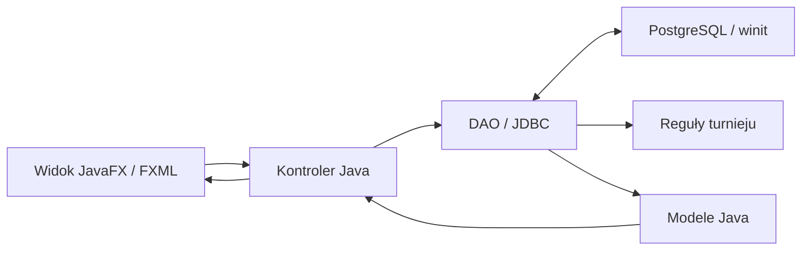

# Jak działa Tournament Creator od strony backendu

Aplikacja desktopowa JavaFX łączy się bezpośrednio z PostgreSQL przez JDBC. Kod
obsługujący dane i reguły turnieju działa w tym samym procesie Java co okno
aplikacji. Kontrolery obsługują akcje użytkownika, DAO wykonują zapytania, a klasy
takie jak `MatchResults` liczą wyniki i sprawdzają reguły rozgrywek.

## 1. Gdzie zacząć czytać kod

| Miejsce | Odpowiedzialność |
| --- | --- |
| `Launcher`, `MainApplication` | Uruchomienie JavaFX, wczytanie `MainScreen-view.fxml` i pokazanie okna. |
| `controllers/MainController`, `utils/ViewManager` | Nawigacja między Dashboard, Players, Teams i Tournaments. |
| `controllers/*SectionController` | Pobranie danych dla sekcji, wypełnienie tabel lub kart, filtrowanie i otwieranie formularzy. |
| `CreatorController`, `*CreatorController`, `OrganizerEditor` | Formularze tworzenia i edycji. Odczyt pól, walidacja, uruchomienie zapisu i komunikaty. |
| `TournamentManagerController` | Obsługa zakładek Teams, Matches, Groups i Bracket. Łączy przyciski z operacjami w DAO. |
| `EventControl`, `MatchOutcomeEditor`, `DeleteTournamentDialog`, `TeamRosterDialog` | Wyspecjalizowane okna do zarządzania stanem turnieju, wyjątkami w wynikach, usuwaniem turnieju i składem drużyny. |
| `dao` | Zapytania SQL, mapowanie wyników, transakcje i reguły wymagające odczytu aktualnego stanu bazy. |
| `models` | Dane przekazywane w Javie, np. `TournamentMatch`, `MapResult`, `TournamentGroup` i `GroupStanding`. |
| `utils` | Reguły turnieju i pomocniczy kod JavaFX. `FxmlViews` ładuje widoki, `ModalManager` pokazuje formularze, `BackgroundTask` obsługuje operacje w tle. |
| `src/main/resources` | FXML opisuje układ, CSS wygląd. `fx:id` wiąże element z polem kontrolera, a `onAction` wskazuje metodę obsługującą kliknięcie. |
| `db/migrations`, `pom.xml`, `build-windows.ps1` | Migracje PostgreSQL, zależności i testy Maven oraz pakowanie wersji Windows. |

Większość modeli to rekordy Java. DAO buduje je z wierszy `ResultSet`.
Przykładowo `TournamentMatch` niesie identyfikatory i nazwy drużyn, format,
status oraz odnośnik do kolejnego meczu. `BracketMatch` służy do obliczenia
drabinki, zanim zostanie zapisana. UUID identyfikuje drużynę lub mecz również
wtedy, gdy zmieni się jego nazwa wyświetlana w aplikacji.

## 2. Połączenie z bazą i wykonanie zapytania

1. Kontroler zbiera dane z formularza. `CreatorValidation` sprawdza m.in.
   długość nazw, dodatni ranking, zakres limitu drużyn i kolejność dat.
2. `BackgroundTask.run()` wykonuje pracę przez `CompletableFuture.supplyAsync`.
   Dzięki temu oczekiwanie na PostgreSQL nie blokuje obsługi okna.
3. DAO otwiera połączenie z `DatabaseManager.getConnection()`. Ta metoda czyta
   `DB_URL`, `DB_USER`, `DB_PASS` ze środowiska lub `.env`. W wersji EXE
   skrypt budowania wskazuje katalog obok pliku wykonywalnego.
4. DAO używa `PreparedStatement` i podstawia wartości w miejsca `?`.
   Dla odczytu mapuje `ResultSet` na modele. Dla zapisu sprawdza wynik
   operacji, w tym liczbę zmienionych wierszy tam, gdzie od niej zależy poprawność.
5. `Platform.runLater()` przekazuje sukces lub błąd na wątek JavaFX.
   Kontroler odświeża widok albo pokazuje komunikat.

Połączenia i zapytania są zamykane przez `try-with-resources`. Gdy jedna akcja
zmienia kilka tabel, DAO wyłącza automatyczny zapis przez `setAutoCommit(false)`.
`commit()` zatwierdza całość, a `rollback()` wycofuje ją po błędzie.

## 3. Jak są powiązane dane

| Tabela w schemacie `winit` | Co przechowuje |
| --- | --- |
| `countries`, `players`, `teams` | Kraje, zawodników i drużyny. `players.team_id` może być pusty, a `team_role` opisuje rolę zawodnika w składzie. |
| `tournaments` | Dane turnieju, limit, stan i informację o archiwizacji. |
| `tournament_participants` | Powiązanie wielu drużyn z wieloma turniejami. Dla danego turnieju przechowuje też rozstawienie i końcowe miejsce. |
| `tournament_groups`, `tournament_group_teams` | Grupy i przypisanie zgłoszonych drużyn do grup. |
| `matches` | Mecz w turnieju, opcjonalna grupa, drużyny, format, status, zwycięzca i połączenie z kolejnym meczem drabinki. |
| `games`, `maps` | `maps` to katalog map. Każdy wiersz `games` to mapa konkretnego meczu, z kolejnością, wynikiem rund i statusem. |
| `tournament_audit` | Historia wybranych operacji, np. zmiany stanu, zapisu wyników i korekt. |

Migracje 001–006 rozszerzają istniejący schemat. Dodają m.in. role w drużynie,
limit, grupy, katalog map, stan i historię turnieju oraz unikalność rankingu.
Wykonuje się je w PostgreSQL osobno od uruchomienia aplikacji.

## 4. Co robią najważniejsze DAO

| Klasa | Metody, od których warto zacząć |
| --- | --- |
| `CountryDAO` | `getAllCountries()` dostarcza kraje do formularza zawodnika. |
| `PlayerDAO` | `getAllPlayers()` odczytuje zawodników z danymi drużyny i kraju. `createPlayer()` dodaje zawodnika. |
| `TeamDAO` | `createTeam()` zapisuje drużynę i przypisuje wybranych wolnych zawodników w jednej transakcji. `assignPlayer()` i `updatePlayerRole()` obsługują skład. |
| `TournamentDAO` | `createTournament()`, `registerTeams()`, `unregisterTeam()`, `updateTeamLimit()` i `deleteTournament()` zarządzają turniejem i zgłoszeniami. |
| `OrganizerDAO` | Metody `update…` zapisują edycje danych. `movePlayer()` przenosi zawodnika lub zwalnia go ze składu. |
| `GroupStageDAO` | `generateGroups()` zapisuje grupy i ich mecze. `generatePlayoffs()` wstawia drabinkę dla zakwalifikowanych drużyn. |
| `MatchDAO` | `getMatches()`, `getMaps()`, `generateBracket()`, `saveScores()`, `saveOutcome()` i `advanceWinner()` obsługują mecze i awanse. |
| `LifecycleDAO` | `act()` wykonuje zmianę stanu, `overview()` wczytuje stan, miejsca i historię, a `audit()` zapisuje wpis historii. |
| `DashboardDAO` | `load()` przygotowuje dane pulpitu, w tym liczniki, harmonogram i ranking. |

Przykład transakcji przy tworzeniu drużyny. Jeśli wybrany zawodnik został
w międzyczasie przypisany gdzie indziej, warunek `team_id IS NULL` sprawi, że
aktualizacja zmieni zero wierszy. DAO zgłosi błąd i wycofa również dodanie
drużyny. Unikalny ranking jest dodatkowo wymuszany przez PostgreSQL po migracji 006.

## 5. Od rejestracji do finału

1. Nowy turniej ma stan **Draft**. W **Event control** organizator otwiera
   rejestrację, zmieniając stan na **Registration**.
2. `registerTeams()` blokuje wiersz turnieju, sprawdza rejestrację i pojemność,
   a następnie zapisuje zgłoszenia i kolejne numery rozstawienia. Jeśli zgłoszenie
   kilku drużyn przekroczyłoby limit, zapis całej paczki jest odrzucany.
3. Organizator tworzy mecze ręcznie, losuje grupy albo generuje drabinkę.
   Po utworzeniu grup lub drabinki nie można już dopisywać drużyn w rejestracji.
4. **Start tournament** wymaga co najmniej dwóch zgłoszonych drużyn i
   istniejących meczów. Ustawia **In progress**, co umożliwia zapis wyników.
   Limit można zmieniać w **Draft** i **Registration**. Po starcie DAO odrzuca
   zmianę, a widok pokazuje wartość limitu jako etykietę.
5. **Finish tournament** sprawdza wyniki i poprawność drabinki.
   `TournamentLifecycle.placements()` wylicza końcowe miejsca, a
   `LifecycleDAO.act()` zapisuje je razem ze stanem **Completed**. Zwycięzca
   finału jest pierwszy, przegrany drugi, a przegrani półfinałów dzielą trzecie
   miejsce. **Cancelled** oznacza anulowanie, a archiwizacja jest osobną flagą.

Stan turnieju i status meczu to dwie różne wartości. Mecz może być **Upcoming**,
**Live** lub **Completed**, podczas gdy cały turniej pozostaje **In progress**.
Filtr statusu w zakładce Matches działa na wczytanej liście w JavaFX.

## 6. Grupy i drabinka

**Grupy.** `GroupStage.draw()` rozstawia drużyny naprzemiennie po grupach.
Każda grupa ma cztery drużyny, więc powstaje sześć par. `GroupStage.standings()`
liczy tabelę z zakończonych meczów. Za wygraną przyznaje trzy punkty. Przy remisie
punktowym porównuje wyniki bezpośrednie zainteresowanych drużyn, różnicę map,
liczbę wygranych map i rozstawienie. Identyfikator drużyny rozstrzyga pozostałe
remisy. Dwa pierwsze miejsca przechodzą do play-offów po zakończeniu wszystkich
meczów grupowych. Po wygenerowaniu play-offów wyniki grup są zablokowane.

**Drabinka.** `SingleElimination.generate()` buduje drabinkę o rozmiarze
najbliższej potęgi dwójki wystarczającej dla liczby drużyn. Przy trzech drużynach
potrzebne są cztery pozycje, więc jedna drużyna dostaje wolny los i przechodzi
od razu dalej. Mecz ma `next_match_id` i `next_match_slot`, które wskazują
mecz następnej rundy i miejsce 1 lub 2. DAO zapisuje finał przed wcześniejszymi
rundami, żeby odnośniki wskazywały już istniejące rekordy.

## 7. Przykład do prześledzenia w kodzie – zapis wyniku Bo3

Załóżmy, że Alpha wygrywa pierwszą mapę 13:8 i drugą 13:11.

1. **Enter / edit scores** otwiera formularz. `TournamentManagerController`
   pobiera zapisane mapy i katalog map.
2. **Save results** wywołuje `TournamentManagerController.saveScores()`.
   Kontroler składa wpisane pola w listę `MapResult` i przekazuje ją do DAO.
3. `MatchResults.evaluate()` sprawdza kolejność i status map oraz ich wyniki.
   W Bo3 potrzeba dwóch wygranych map, więc wynik serii to 2:0, a zwycięzcą jest
   Alpha. Wyniki rund 13:8 i 13:11 są nadal danymi dwóch osobnych map.
4. `MatchDAO.saveScores()` blokuje turniej i mecz oraz porównuje aktualne dane
   z wartościami wczytanymi do formularza. Dzięki temu stare okno nie nadpisze
   wyniku zmienionego przez kogoś innego.
5. DAO zapisuje mapy w `games`, ustawia w `matches` zwycięzcę i **Completed**,
   a w drabince wpisuje Alpha w odpowiednie miejsce kolejnego meczu.
   Aktualizacja drabinki, zapis map, zmiana statusu i wpis historii są częścią
   jednej transakcji. Jeśli zmiana zwycięzcy naruszyłaby już rozpoczęty mecz
   następnej rundy, transakcja zostaje odrzucona.
6. Po sukcesie kontroler ponownie odczytuje dane. W grupie przelicza tabelę,
   a w play-offach odrysowuje drabinkę.

Walkower i wycofanie z meczu zapisuje `saveOutcome()`. Przyznają zwycięzcę
bez tworzenia fikcyjnego wyniku map. Korekty zakończonych wyników wymagają
podania powodu.

## 8. Co warto powiedzieć na obronie

- **Po co DAO?** Kontroler zbiera dane i aktualizuje widok. DAO obsługuje SQL
  oraz spójność zapisu, dzięki czemu zapytania mają jedno konkretne miejsce.
- **Po co blokada `FOR UPDATE`?** Gdy dwa okna próbują zmieniać ten sam
  turniej, zapis czeka na zakończenie drugiej transakcji i sprawdza aktualny
  stan przed zatwierdzeniem. To chroni m.in. limit i awans zwycięzcy.
- **Skąd bierze się zwycięzca?** Wynik pojedynczej mapy wskazuje jej
  zwycięzcę, a liczba wygranych map rozstrzyga mecz. Awans wynika z połączeń
  zapisanych w rekordach drabinki.
- **Gdzie są konta użytkowników?** Aplikacja używa konta PostgreSQL
  wskazanego w konfiguracji. Dostęp do danych wynika z uprawnień tego konta.
- **Co sprawdzają testy?** Dziesięć prostych testów JUnit obejmuje walidację,
  liczenie wyniku i generowanie drabinki. `mvnw.cmd test` uruchamia je bez bazy.
